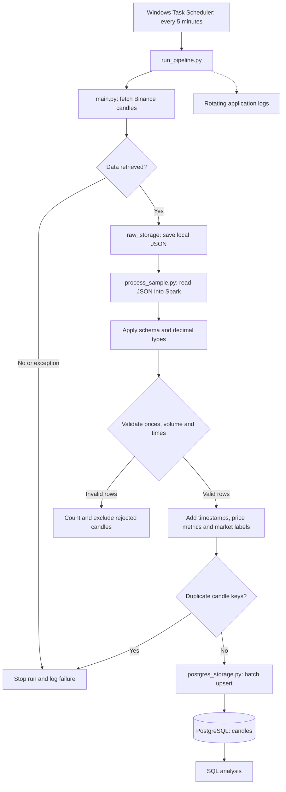

# MarketFlow

An automated batch ETL pipeline that ingests cryptocurrency candle data from Binance, validates and transforms it with PySpark, and loads it into PostgreSQL for SQL analysis.

MarketFlow currently processes the latest **100 BTCUSDT one-minute candles** per run. Overlapping candles update existing database records, while new candle times add new records.

## Process flow



An empty input, no remaining valid candles, duplicate keys, or an uncaught processing/database error stops the run. Rejected rows are counted and excluded; they are not currently stored in a separate quarantine dataset.

## Features

- REST API ingestion with a request timeout.
- Local raw JSON storage, allowing processing to be rerun without another API call.
- Explicit schema for Binance's 12 candle fields.
- Decimal conversion for price and volume columns.
- Validation of required OHLCV values, positive prices, nonnegative base volume, price relationships, and timestamp presence/order.
- UTC timestamp conversion and derived price-change metrics.
- Duplicate-key detection before loading.
- PostgreSQL upserts using a composite primary key.
- Console and rotating file logs, including Python error tracebacks.
- Scheduled execution through Windows Task Scheduler.

## Technology

| Component                   | Technology                          |
| --------------------------- | ----------------------------------- |
| Ingestion and orchestration | Python, Requests                    |
| Transformation              | Apache Spark / PySpark, Spark SQL   |
| Raw storage                 | Local JSON                          |
| Database                    | PostgreSQL                          |
| Database client             | Psycopg 3                           |
| Configuration               | python-dotenv                       |
| Logging                     | Python logging, RotatingFileHandler |
| Scheduling                  | Windows Task Scheduler              |

Spark currently runs on a single machine using `local[2]` and the UTC session time zone.

## Project files

| Path                          | Purpose                                                                |
| ----------------------------- | ---------------------------------------------------------------------- |
| `ingestion/binance_client.py` | Requests candles from Binance                                          |
| `ingestion/raw_storage.py`    | Saves and reads the raw JSON sample                                    |
| `main.py`                     | Runs ingestion and reports whether data was retrieved                  |
| `process_sample.py`           | Converts, validates, enriches and loads candles                        |
| `postgres_storage.py`         | Writes batches to PostgreSQL using upserts                             |
| `run_pipeline.py`             | Configures logging and runs the complete pipeline                      |
| `data/raw/`                   | Raw JSON storage; the exact filename is configured in `raw_storage.py` |
| `logs/marketflow.log`         | Application logs                                                       |
| `.env`                        | Local database connection settings                                     |

## Local setup

Run commands from the project root in PowerShell. Install Python, Java 21, and PostgreSQL first. The development environment used PySpark 4.1.2. Ensure Java is available through `java --version` and that `JAVA_HOME` points to the intended JDK.

### 1. Set up Python

```powershell
python -m venv .venv
.\.venv\Scripts\Activate.ps1
python -m pip install requests "pyspark==4.1.2" "psycopg[binary]" python-dotenv
```

If the virtual environment already exists, activate it without recreating it. Processing sets `PYSPARK_PYTHON` to the active Python executable so Spark workers use the same environment.

### 2. Create the database

In pgAdmin, connect to the default `postgres` database and run this once:

```sql
CREATE DATABASE marketflow;
```

Open a new Query Tool connected to **marketflow**, then create the table:

```sql
CREATE TABLE IF NOT EXISTS candles (
    symbol TEXT NOT NULL,
    interval TEXT NOT NULL,
    open_time BIGINT NOT NULL,
    close_time BIGINT NOT NULL,
    open NUMERIC(28, 8) NOT NULL,
    high NUMERIC(28, 8) NOT NULL,
    low NUMERIC(28, 8) NOT NULL,
    close NUMERIC(28, 8) NOT NULL,
    volume_btc NUMERIC(28, 8) NOT NULL,
    volume_usdt NUMERIC(28, 8),
    trade_count BIGINT,
    taker_buy_volume_btc NUMERIC(28, 8),
    taker_buy_volume_usdt NUMERIC(28, 8),
    price_change NUMERIC(28, 8),
    price_change_pct NUMERIC(28, 8),
    updated_at TIMESTAMPTZ NOT NULL DEFAULT CURRENT_TIMESTAMP,
    PRIMARY KEY (symbol, interval, open_time),
    CHECK (open > 0 AND high > 0 AND low > 0 AND close > 0),
    CHECK (high >= low),
    CHECK (open BETWEEN low AND high),
    CHECK (close BETWEEN low AND high),
    CHECK (volume_btc >= 0),
    CHECK (close_time >= open_time)
);
```

### 3. Configure the connection

Create `.env` beside `postgres_storage.py`:

```dotenv
PGHOST=localhost
PGPORT=5432
PGDATABASE=marketflow
PGUSER=postgres
PGPASSWORD="replace_with_your_database_password"
```

Use the PostgreSQL role password, not pgAdmin's master password. Match the host and port to your running database instance.

Don't forget to add these entries to `.gitignore`:

```gitignore
.env
.venv/
__pycache__/
logs/
```

## Running the pipeline

Fetch new data, process it, and load PostgreSQL:

```powershell
python run_pipeline.py
```

Run ingestion only:

```powershell
python main.py
```

Reprocess the existing saved JSON:

```powershell
python process_sample.py
```

The current configuration uses `BTCUSDT`, interval `1m`, and limit `100` in `main.py`. The symbol and interval labels in `process_sample.py` must match the raw data. Changing these settings is currently a manual change in both places.

## Data model and loading behavior

Each database row represents one Binance candle. Its identity is:

```text
(symbol, interval, open_time)
```

Prices and volumes use `NUMERIC(28,8)`. Raw opening and closing times remain Unix milliseconds in `BIGINT` columns. Readable Spark timestamps are not persisted by the current loader; they can be derived in SQL.

Derived metrics:

```text
price_change     = close - open
price_change_pct = ((close - open) / open) * 100
```

Negative values mean the candle closed below its opening price and are valid.

`postgres_storage.py` streams rows from Spark through the Python driver and writes batches of up to 1,000 rows using one database connection. `ON CONFLICT ... DO UPDATE` updates existing candle keys. A successful transaction commits the load; a failure rolls it back.

Reprocessing the same JSON keeps the row count stable, although `updated_at` changes. Fetching a later batch can increase the count when new candle times appear. The most recent candle may still be forming and can be updated on subsequent runs.

## Querying results

Count stored candles:

```sql
SELECT COUNT(*) AS stored_candles
FROM candles;
```

Inspect recent candles:

```sql
SELECT
    symbol,
    interval,
    to_timestamp(open_time / 1000.0)
        AT TIME ZONE 'UTC' AS open_timestamp_utc,
    open,
    high,
    low,
    close,
    volume_btc,
    price_change,
    price_change_pct
FROM candles
ORDER BY open_time DESC
LIMIT 20;
```

## Logging

Full pipeline runs write application logs to the console and `logs/marketflow.log`. The file rotates at 5 MB and retains up to three backup files.

```powershell
Get-Content .\logs\marketflow.log -Tail 20
```

Look for validation counts, the number of candles written, and the final success message. Spark's Java messages are not necessarily captured by the Python file handler. Running the ingestion or processing scripts directly uses console logging rather than the runner's rotating file handler.

## Scheduling on Windows

Create a task in Windows Task Scheduler with these settings:

| Setting                | Value                                                     |
| ---------------------- | --------------------------------------------------------- |
| Trigger                | Daily; repeat every 5 minutes indefinitely                |
| Program                | Full path to the project's `.venv\Scripts\python.exe`     |
| Arguments              | `run_pipeline.py`                                         |
| Start in               | Full path to the project root                             |
| Overlapping executions | Do not start a new instance                               |
| Missed start           | Run as soon as possible after a scheduled start is missed |
| Initial login setting  | Run only when the user is logged on                       |

The machine must be awake, PostgreSQL must be running, and internet access must be available. Test using **Run** in Task Scheduler and check the log for a new successful run. Avoid launching a manual run while a scheduled run is active.

## Checks performed during development

- Loaded and processed a 100-candle sample.
- Confirmed that valid sample candles passed the implemented checks.
- Injected one repeated candle and detected it with `occurrences = 2`.
- Loaded processed candles into PostgreSQL.
- Confirmed that rerunning processing on unchanged JSON preserved the database row count.
- Observed additional records when later API batches contained new candle times.

These are manual functional checks, not a throughput benchmark or an automated test suite.

## Current scope and limitations

MarketFlow is a local batch ETL project. It has not been load-tested for large-scale workloads.

- Only one configured trading pair and interval are processed.
- Each request fetches the latest 100 candles; there is no pagination, historical backfill, or gap recovery. An extended outage can leave missing candle times.
- Raw storage uses a local sample file rather than an immutable archive; Python loads the JSON into memory before creating the Spark DataFrame.
- Spark uses one machine, and database loading passes through a single Python process and connection.
- Rejected rows are excluded without a separate quarantine store. Validation does not cover every field or possible source-data error.
- Decimal conversion errors stop processing rather than being quarantined.
- Open candles are not explicitly separated from completed candles.
- There is no automatic retry policy, external alerting, or cloud deployment.

## Possible extensions

- Centralize symbol, interval, and batch-size configuration.
- Add historical backfill and incremental checkpoints.
- Preserve raw batches and rejected records for replay and investigation.
- Add automated validation and database integration tests.
- Store partitioned Parquet datasets in S3 and read them directly with Spark.
- Introduce staging tables and bulk loading for higher throughput.
- Add managed scheduling, retries, monitoring, and alerts.

## Author

Youssef Ohmiti
